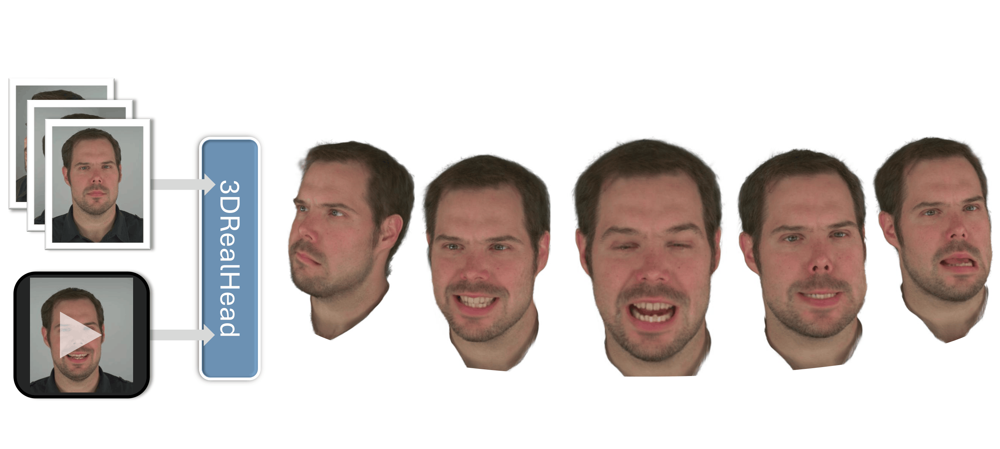

<div align="center">

# 3DRealHead: Few-Shot Detailed Head Avatar

**IEEE Faces & Gestures 2026**

[Jalees Nehvi](https://jalees018.github.io/)<sup>1</sup>, [Timo Bolkart](https://sites.google.com/site/bolkartt/)<sup>2</sup>, [Thabo Beeler](https://thabobeeler.com/)<sup>2</sup>, [Justus Thies](https://justusthies.github.io/)<sup>1</sup>

<sup>1</sup>Technical University of Darmstadt &nbsp;&nbsp; <sup>2</sup>Google

[Project Page](https://jalees018.github.io/3DRealHead/) | [Paper](https://arxiv.org/pdf/2604.13171) | [arXiv](https://arxiv.org/abs/2604.13171) | [Video](https://www.youtube.com/watch?v=F906aIENtGA)



</div>

Given a few-shot input (1-3 images), 3DRealHead reconstructs a 3D head avatar that can be driven by a monocular
input video. A 3D head prior, learned on NeRSemble as a Style U-Net that emits 3D Gaussian primitives, is inverted
from the few input images. The avatar is animated by conditioning the U-Net on 3DMM-based expression signals and on
features of the mouth region extracted from the driving video, which recovers expressions the 3DMM alone cannot
represent.

This repository contains the official implementation.

## Method overview

A StyleUNet generator predicts a UV map of 3D Gaussians from two UV-space conditionings:

1. **expression**: per-texel offsets of the tracked (SMIRK) expression mesh from the subject's neutral mesh, together with a texture-gradient map, and
2. **appearance**: the subject's fitted UV texture.

Each valid texel carries one Gaussian anchored on the FLAME surface. The network predicts a bounded displacement,
opacity, scale and rotation residuals and SH colours; the Gaussians are posed with FLAME linear blend skinning
(rotations are skinned with the same weights) and rendered with 3D Gaussian Splatting from any camera.

```
expression map ─┐                                         FLAME (shape, expr, pose)
texture grad  ──┼─► StyleUNet ─► 59-ch Gaussian UV map ─► anchor on mesh + LBS ─► 3DGS render
UV texture    ──┘
```

## Repository layout

| Path | Content |
|---|---|
| `train.py` | Training on multi-view NeRSemble data (photometric losses + DINO projected discriminator). |
| `test_nersemble.py` | Test-time inversion / fine-tuning on held-out NeRSemble subjects; renders views, turntables and expression-driven videos. |
| `test_itw.py` | Test-time inversion on monocular in-the-wild videos tracked with VHAP. |
| `avatar/` | Dataset, camera loading, UV map → 3D Gaussians, losses, CLIP identity, subject lists. |
| `networks/` | Generator, discriminator and the StyleGAN2 CUDA ops. |
| `flame/` | FLAME layer with UV-space surface sampling. |
| `gaussian_splatting/` | Minimal subset of 3DGS (camera, Gaussian container, renderer, SSIM). |
| `configs/paths.yaml` | All data locations. |
| `scripts/` | `check_install.py` (installation check without data) and `export_samples.py` (packages sample data and a generator-only checkpoint). |
| `assets/` | UV layout, canonical position map, UV masks, frame-sampling statistics; FLAME goes in `assets/flame/`. |
| `submodules/` | `diff-gaussian-rasterization` and `simple-knn` (git submodules). |

## Installation

Tested on Ubuntu 22.04 with an RTX 4090, Python 3.10, PyTorch 2.1.2 and CUDA 11.8.

```bash
git clone --recursive <this repo> 3DRealHead
cd 3DRealHead

conda create -n 3DRH python=3.10 -y
conda activate 3DRH
# CUDA 11.8 compiler + headers inside the env (used to build the extensions below)
conda install -y --override-channels -c "nvidia/label/cuda-11.8.0" cuda-nvcc cuda-cudart-dev cuda-libraries-dev cuda-cccl
pip install torch==2.1.2 torchvision==0.16.2 --index-url https://download.pytorch.org/whl/cu118
pip install -r requirements.txt

# CUDA extensions: 3DGS rasterizer, simple-knn and the StyleGAN2 ops
export CUDA_HOME=$CONDA_PREFIX
pip install --no-build-isolation submodules/diff-gaussian-rasterization submodules/simple-knn networks/ops
```

Set `TORCH_CUDA_ARCH_LIST` (e.g. `"8.9"` for an RTX 4090) to build only for your GPU. With GCC >= 13,
`diff-gaussian-rasterization` may need `#include <cstdint>` at the top of `cuda_rasterizer/rasterizer_impl.h`.

Download `flame2023.pkl` from <https://flame.is.tue.mpg.de> into `assets/flame/`.
CLIP ViT-B/32, DINO ViT-S/16 (timm) and VGG19 (torchvision) weights are downloaded automatically on first use.

Check the installation (no dataset needed; renders a neutral head to `outputs/check_install.png`):

```bash
python scripts/check_install.py --ckpt checkpoints/gaussian_maps.pt
```

## Quick start with sample data

Download the sample data and pretrained generator (**TODO: link**) and unpack it into the repository root.
It contains one held-out NeRSemble subject and one in-the-wild video in the default layout of
`configs/paths.yaml`, plus `checkpoints/gaussian_maps.pt`.

```bash
# NeRSemble: per-subject inversion, then a turntable video / expression-driven video
python test_nersemble.py --ckpt checkpoints/gaussian_maps.pt --subjects <id> --optimize_latent --render_video
python test_nersemble.py --ckpt checkpoints/gaussian_maps.pt --subjects <id> --optimize_latent --render_video \
    --drive_expressions --driving_seq EXP-5-mouth

# In-the-wild video (1-5 frames used for inversion)
python test_itw.py --ckpt checkpoints/gaussian_maps.pt --subjects <name> --num_inversion_frames 3 --render_video
```

Results are written to `outputs/test_nersemble` and `outputs/test_itw`. Run any script with `--help` for all options.
For your own monocular video, track it with [VHAP](https://github.com/ShenhanQian/VHAP), prepare SMIRK meshes and
fitted textures in the layout below, and pass `--subjects <name> --inversion_frames <f0> <f1> <f2>`.

## Data layout

Every location is configured in `configs/paths.yaml` (relative paths are resolved against the repository root);
the comments in that file document each directory. In short:

**NeRSemble**
- `nersemble_export`: VHAP export per subject/sequence (`images/`, `fg_masks/`, `segs/`, `flame_param/`, `transforms.json`)
- `nersemble_color_correction`: per-camera colour-correction matrices
- `nersemble_smirk_meshes`: SMIRK expression meshes
- `nersemble_textures` (training) / `nersemble_test_textures` (testing): fitted UV textures and texture-gradient maps
- `nersemble_clip_images`: one frontal image per subject (training only)

**In-the-wild**
- `itw_vhap_export`, `itw_frames`, `itw_smirk_meshes`, `itw_textures`

## Training

Training requires the full preprocessed NeRSemble data. Copy `configs/paths.yaml`, point it at your data and run

```bash
python train.py --config configs/my_paths.yaml                       # outputs/train/{checkpoints,samples}
python train.py --config configs/my_paths.yaml --ckpt outputs/train/checkpoints/gaussian_maps_600000.pt   # resume
```

`scripts/export_samples.py` packages the files the test scripts need for selected subjects (and strips a training
checkpoint to its generator weights); it is how the sample data was created.

## License

This code is released under a [software copyright license for non-commercial scientific research purposes](LICENSE).
Any commercial use is prohibited; for commercial licensing, contact jalees.nehvi@tu-darmstadt.de.
Third-party components keep their own licenses, listed below.

## Acknowledgements and licenses

This code builds on:

- [3D Gaussian Splatting](https://github.com/graphdeco-inria/gaussian-splatting) (Kerbl et al., 2023):
  `gaussian_splatting/` and the `diff-gaussian-rasterization` / `simple-knn` submodules are derived from the official
  implementation (Inria, non-commercial research license).
- [StyleAvatar](https://github.com/LizhenWangT/StyleAvatar) (Wang et al., 2023): the StyleUNet generator in
  `networks/generator.py` and the StyleGAN2 CUDA ops in `networks/ops/` are adapted from it (the ops originate from
  NVIDIA's StyleGAN2).
- [StyleGAN-T](https://github.com/autonomousvision/stylegan-t): `networks/discriminator.py` (projected DINO
  discriminator) is derived from it (NVIDIA Source Code License, non-commercial).
- [FLAME](https://flame.is.tue.mpg.de) via [smplx](https://github.com/vchoutas/smplx); the FLAME model is subject to
  its own license and is not redistributed here.

Please also cite these works and respect their licenses when using this code.

## Citation

If you find this work useful, please cite:

```bibtex
@misc{nehvi20263drealheadfewshotdetailedhead,
  title={3DRealHead: Few-Shot Detailed Head Avatar},
  author={Jalees Nehvi and Timo Bolkart and Thabo Beeler and Justus Thies},
  year={2026},
  eprint={2604.13171},
  archivePrefix={arXiv},
  primaryClass={cs.CV},
  url={https://arxiv.org/abs/2604.13171},
}
```
